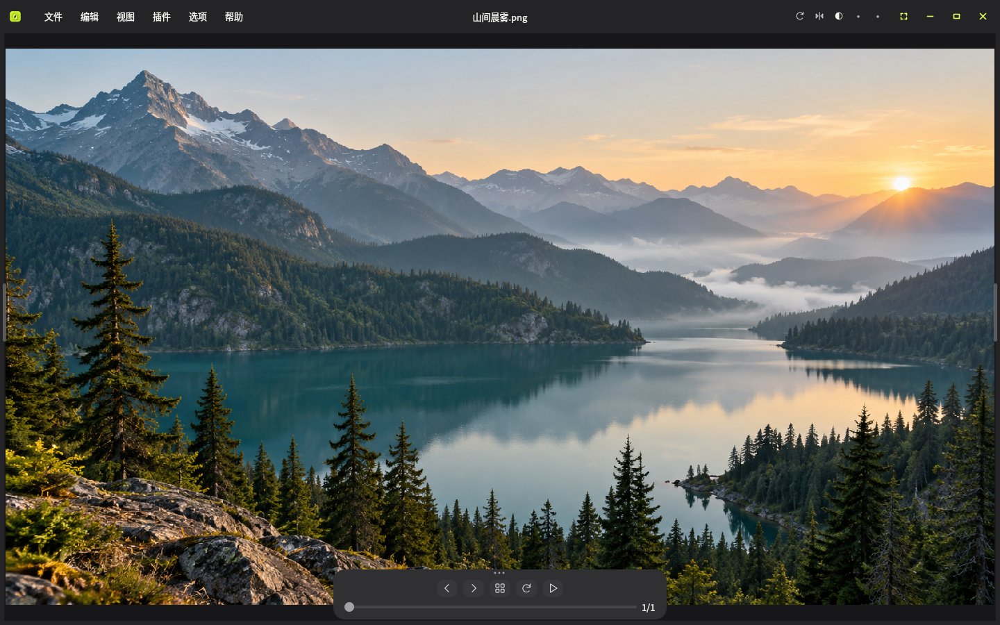
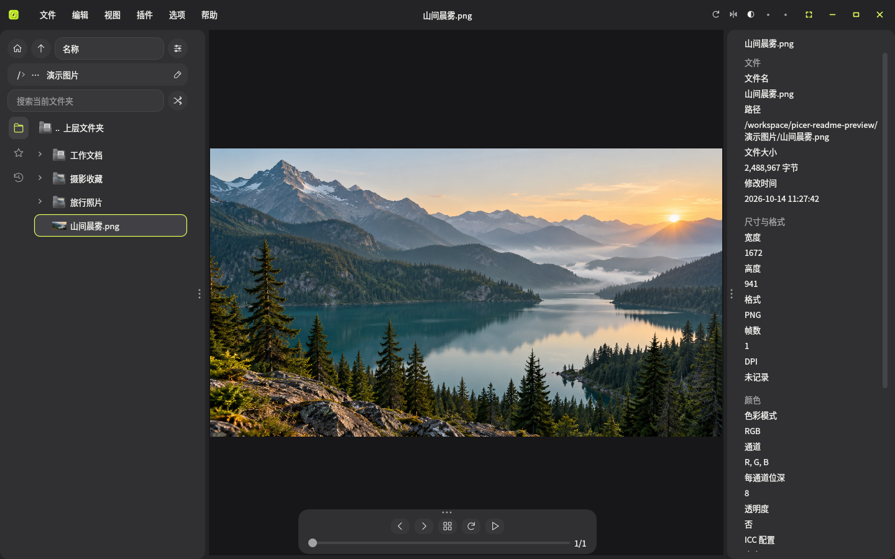
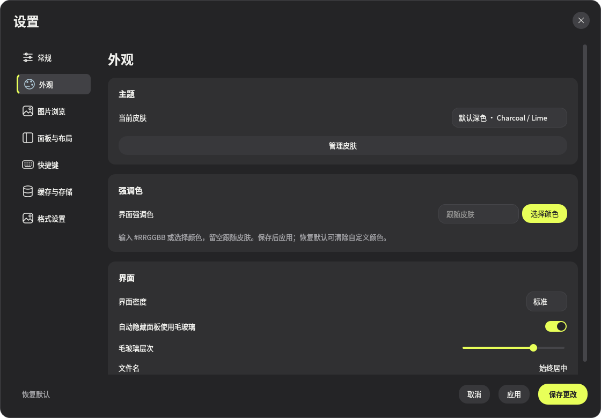
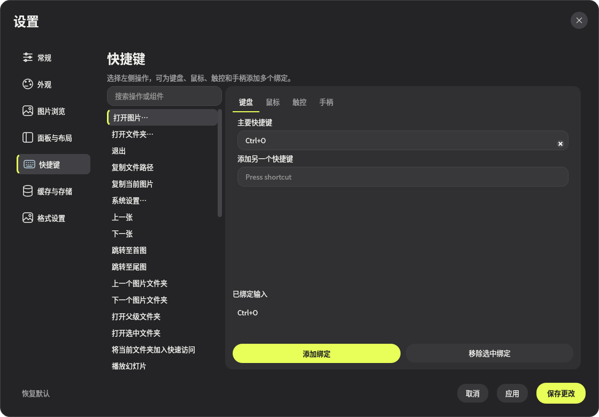
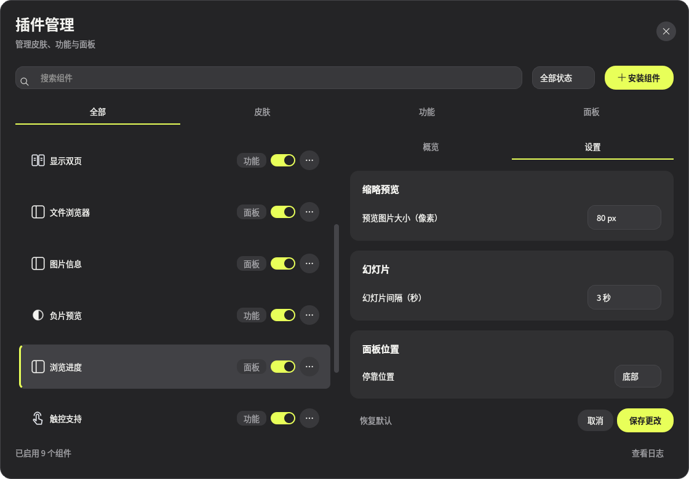

<h1 align="center">揽映 · Picer</h1>

<p align="center">揽景入方寸，映眸见万象。</p>

<p align="center">
  <a href="https://github.com/VonKauland/Picer-browser/releases/latest">下载 Windows 版</a>
  ·
  <a href="#开始使用">开始使用</a>
  ·
  <a href="#常用操作">常用操作</a>
</p>

**揽映是一款使用 AI 编程技术开发的 Windows 本地图片浏览器，也是一件 AI 生成作品。** 开发过程中，使用 OpenAI Codex 进行代码生成、功能实现、问题排查与自动化测试，并由开发者提出需求、确认设计和验收效果。打开照片、浏览整册图片、查看相机信息，或让动态图循环播放，都可以在同一个窗口里完成。

深色界面把空间留给图片。目录、信息和进度面板可以固定，也可以自动收起；需要时，把鼠标移到边缘，它们便会回到手边。



## 0.22.0 更新

- **新增图片管理面板**：支持当前目录内图片的搜索、排序，以及按星级和颜色分类筛选；可切换查看本机曾经标注过的图片，并显示筛选数量。默认关闭，可在插件管理中开启。
- **新增星级评分与颜色分类**：支持半星评分，最高 5 星，以及六种颜色分类，标注结果在图片信息与图片管理面板之间共享。
- **新增临时编辑面板**：支持裁剪、拉伸、旋转、镜像、色阶、色相／饱和度／明度、指定色域保留、像素化及 RGB／分通道曲线调整。各修改器可独立启停，效果实时显示在主画面。默认关闭。
- **新增编辑预设**：可将当前编辑参数命名保存，快速套用到其他图片，并在插件设置中管理。
- **新增编辑结果保存**：保存前二次确认，可选择覆盖原图或保存 PNG 副本，按完整分辨率生成结果。RAW 仅支持保存 PNG 副本；动态图暂不支持临时编辑。
- **增强面板操作**：支持拖动标签调整顺序或更换停靠侧，同侧面板的固定与自动隐藏状态保持同步。
- **完善 Windows 窗口操作**：支持双击标题栏、点击按钮或拖到屏幕顶部最大化，以及拖动窗口边缘和四角调整大小。

[下载 0.22.0 安装版与便携版](https://github.com/VonKauland/Picer-browser/releases/tag/v0.22.0)

## 看图，顺手就好

把图片拖进窗口，或打开一个文件夹，就能开始浏览。滚轮缩放、拖动平移、方向键翻页；全屏时，顶栏自动收起，鼠标移到上边缘即可唤出。

底部进度条可以直接跳到指定位置，也可以展开缩略图，快速找到想看的那张。幻灯片适合慢慢看一组照片，双页模式则能把符合宽度条件的连续图片成对显示。

浏览大图时，揽映先显示预览，再在停留时加载原图，保留当前缩放和位置。切换相邻图片与不同面板查看缩略图时，会复用已有缓存。

## 照片、动态图和相机 RAW

| 内容 | 可以做什么 |
| --- | --- |
| 日常图片 | 浏览 PNG、JPEG、BMP、TIFF、WebP、SVG 等常见格式 |
| GIF / 动态 WebP | 自动播放、暂停，拖动播放条定位到某一帧 |
| 相机 RAW | 读取 DNG、CR2 / CR3、NEF、ARW、RAF、RW2 等格式，查看可读取的相机信息 |

日常浏览中的旋转、翻转和灰度预览只改变当前显示。图片在本地处理，不上传照片；使用临时编辑时，只有确认保存才会写入原图或副本。

具体相机型号和 RAW 变体的兼容性取决于 LibRaw。完整格式与读取说明见 [图片格式与浏览性能](https://github.com/VonKauland/Picer-browser/blob/main/docs/media.md)。

## 目录和信息，就在手边

文件浏览面板支持列表和平铺，图片带有缩略预览，含图文件夹还能显示内部首图。地址栏可以逐级返回，常用目录可以加入揽映自己的快速访问。

搜索只查当前层的文件和文件夹，历史记录方便回到刚才的位置。主画面切图时，浏览面板会在同一目录中同步选中当前图片。

图片信息面板展示尺寸、格式、颜色和直方图；有 EXIF 的照片，还能查看相机、镜头、光圈、快门、ISO 和焦距，并展开更详细的拍摄信息。



## 按自己的习惯来

强调色、界面密度、面板布局和自动隐藏效果都可以调整。设置窗口打开时仍能操作主画面，点击「应用」就能看到变化；自己的配置也能导出备份。



键盘、鼠标、触控和 XInput 手柄分别设置。一个功能可以绑定多个输入，冲突时会提示；手柄支持肩键组合，例如 `RT + A`。触控和手柄默认不分配功能，由你决定怎样操作。



## 需要什么，就启用什么

揽映用插件扩展皮肤、功能和面板。文件浏览、图片信息、浏览进度，以及双页、触控支持等组件已经随软件提供，可以在插件管理中启停和调整。

面板的具体选项集中在插件管理的「设置」页，系统外观和浏览习惯则放在「选项 → 系统设置」。顶部五个快捷位可以放上常用功能。



想添加更多能力，可以安装可信来源的插件 ZIP；新安装的第三方插件需要手动启用。开发自己的插件，可从 [插件开发文档](https://github.com/VonKauland/Picer-browser/blob/main/docs/plugins.md) 和 [示例组件](https://github.com/VonKauland/Picer-browser/blob/main/docs/example-components.md) 开始。

## 开始使用

打开 [GitHub Releases](https://github.com/VonKauland/Picer-browser/releases/latest)，选择适合自己的版本：

- **安装版**：下载 `Picer-版本号-windows-x64-setup.exe`，按向导安装。可选择桌面快捷方式、Windows「使用揽映打开」右键菜单和默认图片浏览器；Windows 集成默认不勾选。选择默认浏览器后，在安装完成时打开 Windows 默认应用设置并确认关联。
- **便携版**：下载 `Picer-版本号-windows-x64-portable.zip`，完整解压后进入 **Picer** 文件夹，双击 **Picer.exe**。

启动后，拖入图片或按 `Ctrl + O` 即可开始浏览。

两种版本都无需安装 Python。便携版请保留完整软件文件夹，运行库和资源与 EXE 一起使用。Releases 附件可直接下载，也提供 SHA256 校验值。

更新时，把新版解压到新目录，再迁移旧版的 `plugins`、`skins` 和 `config`，即可保留插件与设置。更多说明见 [安装、更新与迁移](https://github.com/VonKauland/Picer-browser/blob/main/docs/distribution.md)。

## 常用操作

| 操作 | 默认方式 |
| --- | --- |
| 打开图片 / 文件夹 | `Ctrl + O` / `Ctrl + Shift + O` |
| 上一张 / 下一张 | `←` / `→` |
| 缩放 / 平移 | 鼠标滚轮 / 拖动图片 |
| 适应窗口 / 原始大小 | `Ctrl + 0` / `Ctrl + 1` |
| 切换全屏 | `F11` |
| 复制图片 / 文件路径 | `Ctrl + C` / `Ctrl + Shift + C` |
| 浏览面板返回上层 / 进入选中文件夹 | `Backspace` / `Enter` |
| 将浏览面板当前目录加入快速访问 | `Ctrl + F` |
| 插件管理 / 系统设置 | `Ctrl + Shift + P` / `Ctrl + ,` |

右键点击图片，也能复制图片或路径、在资源管理器中定位文件，以及切换全屏。更多绑定方式见 [输入设置](https://github.com/VonKauland/Picer-browser/blob/main/docs/input.md)。

## 开发与文档

项目使用 Python 3.12 和 PySide6，面向 Windows x64。需要从源码运行时：

```powershell
py -3.12 -m venv .venv
.\.venv\Scripts\python.exe -m pip install -r requirements-dev.txt -e .
.\.venv\Scripts\python.exe -m picer
```

[系统设置](https://github.com/VonKauland/Picer-browser/blob/main/docs/settings.md) · [插件 SDK](https://github.com/VonKauland/Picer-browser/blob/main/docs/plugins.md) · [组件规范](https://github.com/VonKauland/Picer-browser/blob/main/docs/components.md) · [Windows 构建](https://github.com/VonKauland/Picer-browser/blob/main/docs/distribution.md#构建与验证)

<sub>截图来自当前版本的源码运行界面，使用演示图片。</sub>
