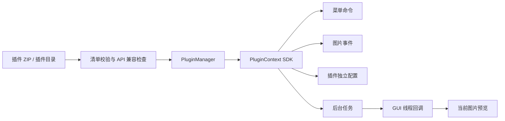

# Picer 插件系统 v1

揽映将图片处理能力放在插件层。内置 `picer.transforms`、`picer.mirror` 和 `picer.grayscale` 使用与第三方相同的 SDK 分别提供旋转、水平翻转和灰度预览；主窗口负责图片显示、文件导航和窗口操作。插件不需要修改宿主源码。

新开发请先阅读 [三类组件规则](components.md)：明确声明 `type` 为 `skin`、`function` 或 `panel`，功能单按钮、面板单 QWidget，皮肤独立安装到 `skins`。

## 架构与生命周期



- 发现只读取 `manifest.json`，不会导入代码。新安装的第三方插件默认停用。
- 启用时先按依赖关系加载依赖，再导入入口类并调用 `activate(context)`。依赖缺失、循环、API 不兼容会阻止启用。
- 激活失败时撤销部分注册；此次新启用的依赖也回滚，原已启用依赖保持运行。
- 停用时先撤销上下文，再调用可选的 `deactivate()`。无论清理钩子是否抛出普通异常，宿主都会删除菜单命令、快捷键、事件订阅和模块命名空间，并取消后台任务。
- 停用有运行中依赖者的插件会被拒绝，需先停用依赖者。关闭应用按依赖者优先的顺序清理。
- 插件命令、事件、激活和后台任务抛出的普通 Python 异常会被记录；出错插件和依赖它的插件会停用，宿主保留当前图片。
- 重载先停用再重新校验清单、清理字节码缓存并重新导入；重载失败保持停用，不继续使用旧实例。
- 更新只允许覆盖已停用的第三方插件，保留独立配置并保持停用。不能覆盖或卸载内置插件。

## 用户操作

打开 **插件 → 插件管理**，或按 `Ctrl+Shift+P`：

1. 选择 **安装/更新 ZIP…**，安装后查看名称、版本、来源、权限、依赖和错误。
2. 确认来源可信后点击 **启用**，依赖会一并启用。
3. 在 **插件 → 功能** 勾选启停，通过 **调用功能** 或快捷位执行；命令也可同时出现在 **编辑**、**视图** 菜单。皮肤与面板各有二级菜单。
4. 可停用、重载或卸载；更新前先停用，卸载同时删除该插件配置。

**打开插件目录** 可查看实际存储位置。文件夹版本默认使用 EXE 所在目录保存数据；源码开发或软件目录不可写时使用用户目录。也可通过 `--data-dir` 指定位置。

```text
Picer/
  Picer.exe
  config/plugins.json           启用状态与插件独立设置
  logs/plugins.log              异常日志（256 KiB 轮转，保留两份旧日志）
  cache/
    thumbnails/                 宿主缩略图缓存
    plugins/<plugin-id>/        插件独立缓存
  plugins/
    example.negative/
      manifest.json
      main.py
```

资源、迁移与备份规则详见 [文件夹分发指南](distribution.md)。

配置使用临时文件与原子替换保存。无法读写配置时仍允许查看图片，诊断显示在插件管理中。直接复制目录的插件在下次启动发现；改动运行中插件的源码后点击 **重载**。

出现第三方插件启动问题时可运行 `Picer.exe --safe-mode`，本次跳过第三方发现和自动启用，不删除插件或改写其启用偏好。内置插件仍按已有偏好加载。

## 插件包结构

ZIP 根目录直接包含清单与入口，不能额外包一层文件夹：

```text
negative-plugin.zip
  manifest.json
  main.py
  helper.py                     可选：通过相对导入使用
  resources/                    可选资源
```

安装器限制为最多 500 项、解压后最多 20 MiB，并拒绝路径穿越、符号链接、重复路径、大小写冲突和 Windows 特殊路径。安装校验是文件完整性检查，不证明代码可信。

`manifest.json`：

```json
{
  "id": "example.negative",
  "name": "负片预览",
  "version": "1.1.0",
  "type": "function",
  "api_version": 1,
  "entrypoint": "main:Plugin",
  "description": "当前图片反色预览，不修改原文件。",
  "author": "Your Name",
  "permissions": ["ui.commands", "image.read", "image.modify", "tasks"],
  "requires": []
}
```

| 字段 | 规则 |
| --- | --- |
| id | 稳定、全局唯一，小写字母开头的点分标识符；内置 id 为 `picer.transforms` |
| name / version | 非空名称；版本格式 `major.minor.patch` |
| api_version | 当前仅支持整数 `1`，不匹配的插件不执行 |
| type | 新开发必须声明 `skin`、`function` 或 `panel`，见组件规则 |
| entrypoint | `module:Class`；模块可为多层包，如 `effects.main:Plugin` |
| permissions | API 能力声明，见下表 |
| requires | 插件 id 列表；v1 校验依赖存在及依赖自身的 API 兼容，不解析插件版本范围 |
| description / author | 可选字符串 |

`main.py` 最小示例：

```python
from picer.plugins import PluginContext

class Plugin:
    def activate(self, context: PluginContext):
        self.context = context
        context.add_command("invert", "反色预览", self.invert)

    def invert(self):
        image = self.context.image()
        image.invertPixels()
        self.context.replace_image(image)

    def deactivate(self):
        pass
```

注册 ID 在每个插件内唯一；宿主内部使用 `插件id:命令id`。快捷键与宿主及其他运行中插件冲突时会拒绝注册并回滚激活。默认 `requires_image=True`，未打开图片时命令不可用。

多文件插件使用 `from .helper import ...`；宿主给每个插件分配独立模块命名空间，不向全局 `sys.path` 插入插件目录。插件资源可基于模块的 `__file__` 定位。

## SDK API

| 权限 | API | 行为 |
| --- | --- | --- |
| settings | `add_settings(fields, on_apply)` / `show_settings()` | 声明 SettingField 设置表单，在插件管理的内嵌设置页应用 |
| image.navigate | `open_image(path)` / `navigate(offset)` / `jump_to(index)` | 打开或按浏览方向导航、按零起始文件索引绝对跳转 |
| image.read | `image_paths()` | 当前目录顺序的 Path 元组快照 |
| image.read | `readable_suffixes()` | 用户当前启用格式的 frozenset，例如 `{'.png', '.jpg'}` |
| image.read + tasks | `request_metadata(callback)` | 后台读取原图元数据，丢弃过期结果 |
| image.read + ui.panels | `show_focus_points(data)` | 当前原图的归一化合焦框；传 `None` 移除，停用组件时自动清理 |
| image.read + ui.panels | `set_raw_camera_preview(enabled)` | 切换 RAW 内嵌机内预览，停用组件时撤销；编辑未保存时拒绝切换 |
| ui.panels | `frosted_surface(parent, popup=False)` | 创建共享玻璃界面；嵌在固定面板内时不透明，自动隐藏或弹出窗时使用毛玻璃 |
| ui.panels | `add_panel(widget, area="right")` | 仅面板类，注册一个停靠面板；普通面板支持 left/right；panel_role: progress 仅 bottom，停用时删除 |
| ui.commands | `add_command(id, label, callback, shortcut="", requires_image=True, menu="插件")` | 注册单功能动作，可传入 icon=QIcon；省略或传入空图标时由宿主提供默认图标；停用时删除，宿主皮肤保留外部图标 |
| image.read | `current_path()` | 返回当前 `Path`，未打开图片时为 `None` |
| image.read | `image()` | 返回当前预览的独立 `QImage` 拷贝，包含当前显示变换 |
| image.read | `thumbnail()` | 返回当前原图的独立缩略图拷贝，不含插件预览变换 |
| cache | `cache_directory()` | 返回 `cache/plugins/<plugin-id>` 独立目录，插件自行控制容量 |
| image.modify | `replace_image(image)` | 更新显示并适应窗口，发出图片变更事件；不写原文件 |
| events.subscribe | `subscribe(name, callback)` | 订阅图片、动画或外观事件，停用时自动撤销 |
| settings | `get_setting(key, default=None)` / `set_setting(key, value)` | 插件命名空间下的 JSON 设置；读取返回副本，单值最多 64 KiB 序列化 JSON |
| tasks | `run_task(work, on_result, image_bound=True)` | 后台计算，结果在 GUI 线程交付，返回取消令牌 |
| 无额外声明 | `notify(message)` | 显示纯文字、不可交互的毛玻璃通知气泡；默认 1 秒，跟随系统时长设置 |

所有上下文 API 必须在 GUI 线程调用；停用后的上下文不可继续使用。插件清理钩子自行停止自己创建的资源，不应再注册命令或访问上下文。

### 事件

- `image.opened`：成功打开图片后发送。
- `image.changed`：打开或替换当前预览后发送。

回调参数为不可变 `ImageEvent(path, width, height, reason)`；`reason` 为 `opened` 或 `edited`。事件是发送开始时的元数据快照。事件回调中再次替换图片会更新画面，但不递归发送新的事件，避免反馈循环。

### 后台任务

大图计算应使用工作线程。先在 GUI 线程获取图片拷贝，工作函数接收 `TaskToken`：

```python
image = context.image()

def work(token):
    token.checkpoint()
    image.invertPixels()
    token.checkpoint()
    return image

token = context.run_task(work, context.replace_image)
# token.cancel() 请求取消；token.cancelled 查询状态。
```

工作线程禁止调用上下文或操作 QWidget/QPixmap；使用独立的 QImage 数据计算。`on_result` 在 GUI 线程调用，可以使用上下文。插件停用后结果丢弃；默认情况下，用户切换图片或修改预览后，旧任务结果也丢弃。与图片无关的工作可指定 `image_bound=False`。最多同时排队 16 个插件任务。

取消是协作式的；工作函数应定期 `checkpoint()`。宿主不会强制杀死 Python 线程，无法中断不配合的无限循环或阻塞原生调用。

## 随附示例与构建验证

`examples/negative_plugin` 展示菜单、图片读写、事件、设置和后台任务。Windows Actions 会将其打包为 `Picer/examples/sdk/negative-plugin.zip`，随完整软件文件夹上传。

手动打包：

```powershell
Compress-Archive -Path examples/negative_plugin/* -DestinationPath negative-plugin.zip -Force
```

CI 在实际 EXE 中安装这个外部 ZIP、启用插件、读取 PNG/JPEG、执行内置旋转及外部异步反色、检查配置和停用清理，以验证冻结后动态导入仍可用。

## 运行边界与演进

v1 是可信 Python 插件系统，运行在宿主进程中。权限声明只控制 SDK 调用，不能阻止插件直接访问文件、网络或 Python 私有对象。普通异常隔离不覆盖原生崩溃、主动退出或恶意代码；需要运行不可信扩展时，后续应增加独立进程与受限 IPC，而不是把当前声明误称为沙箱。

冻结 EXE 中只保证宿主已打包的 Python/Qt 模块可用。不会自动执行 pip 或下载依赖。插件可携带纯 Python 相对导入模块；额外原生库、未打包标准库模块或其他 Qt 模块需要专门适配和构建验证。

后续可在稳定 SDK 上增加：独立进程插件、解码器与导出器注册、撤销栈、插件版本依赖范围与签名分发。目前没有实现插件商店、网络更新或不可信插件沙箱。

SettingField 支持 bool、int、choice、path、text；字段包括 key、label、kind、default、minimum、maximum、choices。`add_settings` 只注册一次，清理上下文时移除表单。完整实例与参数范围见 [示例组件说明](example-components.md)。

`show_settings()` 定位到插件管理中当前组件的设置页；默认面板不要增加设置按钮。`from picer.plugins import ui_icon` 可获取宿主随附的静态细线图标（`folder`、`home`、`up`、`left`、`right`、`grid`、`rotate`、`play`、`pause` 等），颜色默认为白色，保持独立于宿主皮肤。API v1 生命周期与权限契约不变。

Picer 0.8.1 提供 `from picer.plugins import RoundedSlider`，它是 QSlider 子类，采用透明背景、4px 圆头轨道与圆形滑块，保留 Qt 原有的范围、拖动、tracking、键盘与无障碍行为；支持横向、竖向、反向显示。插件面板中的控件配色独立于宿主皮肤。原有 QSlider 和 API v1 插件仍可使用。

## Picer 0.10.0 媒体扩展（API v1 兼容新增）

- `open_image(path)` 对 RAW、大图和动画返回是否接受读取请求；接受不代表后台解码已经成功。`image.opened` 在首个画面到达后发送。较小普通图片继续同步返回结果。
- `image_paths()` 返回可复用的不可变路径快照，`image_index()`（image.read）通过位置映射返回当前图片的零起始索引，无图片时为 -1。在超大目录首次索引完成前可能只有当前图片；目录更新后会发送 `image.changed`，reason 为 `indexed`。
- `image()` 返回当前显示的像素快照，渐进读取期间可能是低分辨率预览。用 `rotate_image()`（image.modify）旋转可保留后续原图替换和动画播放；`replace_image()` 将当前显示转为静态图并取消替换。
- `animation_state()`（image.read）返回不可变 `AnimationState(active, playing, frame, count, duration)`，frame 从 0 开始，duration 为当前帧延时毫秒，静态图片 active 为 False。
- `seek_animation(frame)` 与 `toggle_animation()` 需要 image.navigate；拖动保持当前播放/暂停状态，越界参数抛出 PluginError。
- `subscribe("animation.changed", callback)` 需要 events.subscribe，回调参数为 AnimationState。帧更新不重复发送 image.opened/image.changed，也不取消普通元数据任务。
- `AnimationState` 可从 `picer.plugins` 导入；仍沿用 API_VERSION=1，原插件无需新增权限或修改代码。旋转的 image.changed reason 为 `rotated`。

格式、渐进解码与资源上限见 [媒体与性能说明](media.md)。

### 自定义强调色（0.12，仍兼容 API v1）

- `context.accent_color()` 需要 `ui.panels`：返回用户显式指定的强调色，未指定时返回插件默认黄绿 `#E8FF59`，不会读取宿主皮肤的强调色。
- `subscribe("appearance.changed", callback)` 需要 `events.subscribe`，应用设置保存后回调参数包含 `{"accent": "#RRGGBB", "formats": [".jpg", ".png", ...]}`；停用 / 出错自动撤销。插件应在激活时读取 `accent_color()` 初始化，并在回调中更新自行绘制的选中状态。文件类插件可用 `readable_suffixes()` 同步格式筛选，`formats` 变化时丢弃旧索引和待处理的目录分类结果；兼容此前仅读取 `accent` 的插件。
- 宿主共享控件随用户设置更新，外部插件原始 QSS 与自有 QIcon 不被改写；示例浏览器与进度条主动订阅外观变化。皮肤仍只影响宿主。
- 固定面板外壳不透明，自动隐藏弹出才使用玻璃；`frosted_surface` 的子界面在固定面板中同样不透明，独立弹出窗仍可使用玻璃。

### 结构化 EXIF（0.13）

`request_metadata` 保留原 `exif` 字典，并增加 `exif_sections`：`基础信息` 为标签 / 值映射，`详细信息` 为分组 / 标签 / 值映射。无相机标签的图片不显示 EXIF 区域，缺少个别字段显示 `未记录`。RAW 标签解析独立于像素解码，无法生成直方图时仍可返回相机信息与警告。

`focus_points` 保留 `boxes`（最多 512 个归一化 `x, y, width, height`）和 EXIF `orientation`，新增 `faces`（最多 64 个同格式人脸框）、`eyes`（最多 64 个同格式眼部识别框）与 `face_points`（最多 64 个归一化 `x, y` 人脸中心）。`show_focus_points` 向后兼容只有 `boxes` 的 API v1 数据。对焦区域显示实线，人脸及眼部区域显示虚线；只有中心的记录显示小型虚线定位标记。没有可识别记录时返回空数组，不推测中心。CR3 按容器边界读取 CMT1–CMT4，其他 RAW 定点读取元数据或内嵌 JPEG 头部，不扫描像素数据。切换图片、修改图像几何或停用组件时清理，不改写像素。[厂商与结构覆盖范围](camera-regions.md) 包含尚未支持的机型／记录说明，适马 fp／fp L 的样本映射及实际验证范围。


`request_metadata` 还可返回 `raw_camera_preview_available` 和 `ai_generation`。
前者表示 RAW 有可读取的内嵌相机 JPEG / 位图；`set_raw_camera_preview(bool)` 切换该效果与 RAW 解码，
两种模式缓存隔离，停用面板时撤销。内嵌预览的分辨率由相机决定，缺失时使用 RAW 解码。
`ai_generation` 为 `source`、`message` 和 `fields` 标签 / 值列表，仅依据文件内嵌的生成记录识别
Stable Diffusion / ComfyUI，不分析画面推测来源，不执行工作流或读取其引用的模型文件。
对焦标记保留原记录中心，显示宽高为记录区域的三分之一。
视频后缀包含在 `readable_suffixes()` 中，仅支持带毛玻璃胶片边框的静态封面；
缩略图仍经过同一个服务和缓存，不创建播放器或音频输出。图片专用组件可排除 `picer.video.VIDEO_SUFFIXES`。

### 共享缩略图缓存（0.14 起，API v1 兼容扩展）

所有缩略图功能应使用 `context.request_thumbnail(path, on_result, edge=128, priority=False)`。
需声明 `image.read` 和 `tasks` 权限；在 GUI 线程请求，回调同样在 GUI 线程收到 QImage。
`edge` 为 16～256 像素，`priority=True` 用于优先显示当前可见预览。返回的 token 可调用 `cancel()`。
切换主图不会自动取消请求；插件应在视图变化时取消旧请求。停用、卸载或上下文撤销会自动取消回调。
缺失、损坏或不支持的图片返回空 QImage，不使插件停用；插件可画占位图。

宿主统一在 `cache/thumbnails/` 持久化自动应用 EXIF 方向的 256px 母图，各显示尺寸共享母图；内存缓存最多 256 张 / 32 MiB。
磁盘缓存最多 4096 张，同时遵守应用设置中的缓存容量。源路径、修改时间与文件大小参与索引；文件更新自动失效。
同时请求同一文件会合并解码，专用线程池最多解码 2 张；宿主已读图片的缓存写入使用另一个串行队列，避免挤占主图加载或原图精修线程。可见预览优先，逐张返回，无整批等待。
0.14.1 起，内存与磁盘维护使用不同的锁；容量索引在普通读写时增量更新，初始 / 显式维护扫描在后台串行队列进行，避免界面等待磁盘写入、目录扫描或清理。宿主先用已读的原始预览预热内存，再异步保存，当前动态图缩略图也不会重新打开源文件。

视图可保留 QIcon 等绘制对象，但不应另建源图解码或持久化缩略图缓存；`cache_directory()` 继续用于插件其他临时数据。
**帮助 → 清理图片缓存** 清理共享内存和磁盘缓存；正在解码的旧任务不会重新写入已清理的缓存。

```python
self.thumbnail_request = context.request_thumbnail(
    image_path, self.display_thumbnail, edge=80, priority=True
)
# 在面板切换目录等操作中取消不再需要的结果：
self.thumbnail_request.cancel()
```

## 显示布局与触控输入扩展（API v1）

功能插件可使用 `add_command(..., checkable=True, checked=False)` 注册可勾选按钮，返回 `QAction`。原有调用方式兼容。`image.layout` 权限允许 `context.set_double_page(bool)`；`input.touch` 权限允许 `context.set_touch_enabled(bool)`。两种能力均由宿主管理，停用或异常时撤销；外部插件的权限仍不是 Python 沙箱。

键盘默认值通过 `shortcut` 声明；用户在应用快捷键设置中可覆盖为多个键盘、鼠标或触控绑定。宿主保存默认声明与用户覆盖，停用时移除活动输入映射，保留设置供再次启用。预装实例见 `examples/double_page` 和 `examples/touch_support`。

## 面板接入宿主可绑定操作（0.17）

`ui.panels` 权限的面板可调用 `context.bind_panel_operation(name, callback)` 接入已定义的宿主操作，不额外注册功能按钮：`browser.parent`、`browser.selected`、`browser.favorite`、`slideshow.play`、`slideshow.stop`。回调均无参数。每个操作只能有一个提供者，停用 / 出错 / 卸载自动撤销；启用失败同样清理，键盘绑定仍保留。`context.handle_browser_key(event)` 让面板视图在 ShortcutOverride / KeyPress 阶段使用用户设置的父级 / 选中目录按键；文本编辑器应保留原生输入行为。回调只在 GUI 线程运行，通过宿主异常隔离调用。

面板内部的 Qt 滚动区域由系统统一控制是否显示滚动条，不影响滚动能力；不覆盖原本禁止的横向滚动策略。自绘缩略条保持原有无滚动条设计。

### Shared photo annotations (API v1 additive methods)

`image_annotation(path)` reads one local record; `image_annotations()` returns a detached
snapshot keyed by absolute image path. Both require `image.read`. Each record has `rating`
(`None` or 0–5, in half-star steps) and `color` (empty, red, orange, yellow, green, blue,
or purple). `set_image_annotation(path, rating=..., color=...)` additionally requires
`image.annotations`; omitted fields are unchanged, rating 0 clears a score and empty color
clears a category. These calls run on the GUI thread and never modify original image files.
`annotations.changed` carries `{"path": "..."}` and uses the existing revocable subscription
lifecycle. Device-local marks live separately in `config/annotations.sqlite3`; the first
startup imports the shipped information panel's older ratings/color settings once, without
overwriting newer records. Panel disable/uninstall does not delete photo annotations.

The shipped `example.images` / 图片管理 panel is installed but **disabled by default**.
When enabled it defaults to the right side, lists only supported image files in the current
viewer's folder (no child directories), and uses a virtualized tiled view with two default
columns. Search, sorting and star/color filters share the annotation index. Turning off
“仅本文件夹” queries only existing supported images already marked in this installation;
it never scans drives. Filter counts respect the search/scope and the other filter facet.
Clicking the final star's left half in a rating row selects a half-star threshold. Thumbnail
pixels always come from the shared host service, with bounded visible requests and watches.

### Temporary editor and custom settings (additive API v1)

`create_editing_session()` requires `ui.panels`, `image.read`, `image.modify` and
`tasks`. A component can own one host editing session; disabling it revokes its
workers, canvas tools and subscriptions and restores the source view. The shipped
`example.editor` panel defaults off and docks right when first enabled.

`add_settings_page(factory)` requires `settings`. The factory receives the parent
and returns a QWidget implementing `save() -> bool` and `reset()`. It is embedded
in Plugin Management using the same Apply/Cancel lifecycle; it cannot be combined
with `add_settings` for the same component. Existing declarative forms are unchanged.

The temporary editor keeps a bounded 1600px working preview and computes saves from
the original resolution off the GUI thread. Each modifier has an independent enable
switch; disabling it preserves its parameters. Named recipes (up to 64, subject to
the SDK's 64 KiB setting limit) live in the editor's plugin settings. Only the top
navigator contains a photo thumbnail; modifier charts are parameter controls.

Selective color preserves a target hue range and grays other colors, with circular
hue distance and adjustable transition. Cropping uses source-relative coordinates;
the canvas selection tool and numeric fields share the same recipe. Curves support
RGB and individual channels with up to 16 ordered, piecewise-linear nodes.

Save confirmation offers Cancel, Overwrite and PNG Copy. Copies allocate a unique
sibling name. Overwrite supports PNG/JPEG/WebP/BMP/TIFF; RAW and other readable still
formats export to PNG. Animated inputs are explicitly excluded from this editor.
All saves check the original fingerprint, render full resolution, write/fsync a
sibling temporary file, then atomically replace the target. Errors preserve the
original; JPEG/BMP flatten transparency onto white. Readable EXIF/ICC metadata is
preserved where the output supports it, with normalized orientation/dimensions.


### 界面语言兼容

宿主支持 `zh_CN`、`zh_TW`、`en`、`ru`、`ja`、`ko`、`es`，保存后重启生效。
自带插件使用宿主离线翻译资源，并以原始操作 ID、配置键和元数据字段名保存数据；第三方组件的名称、说明、功能标签与用户输入不被自动翻译。
本次保持 API v1，不要求外部组件修改清单或新增依赖。`focus_points`、EXIF 字典、路径与绑定结构保持兼容。
